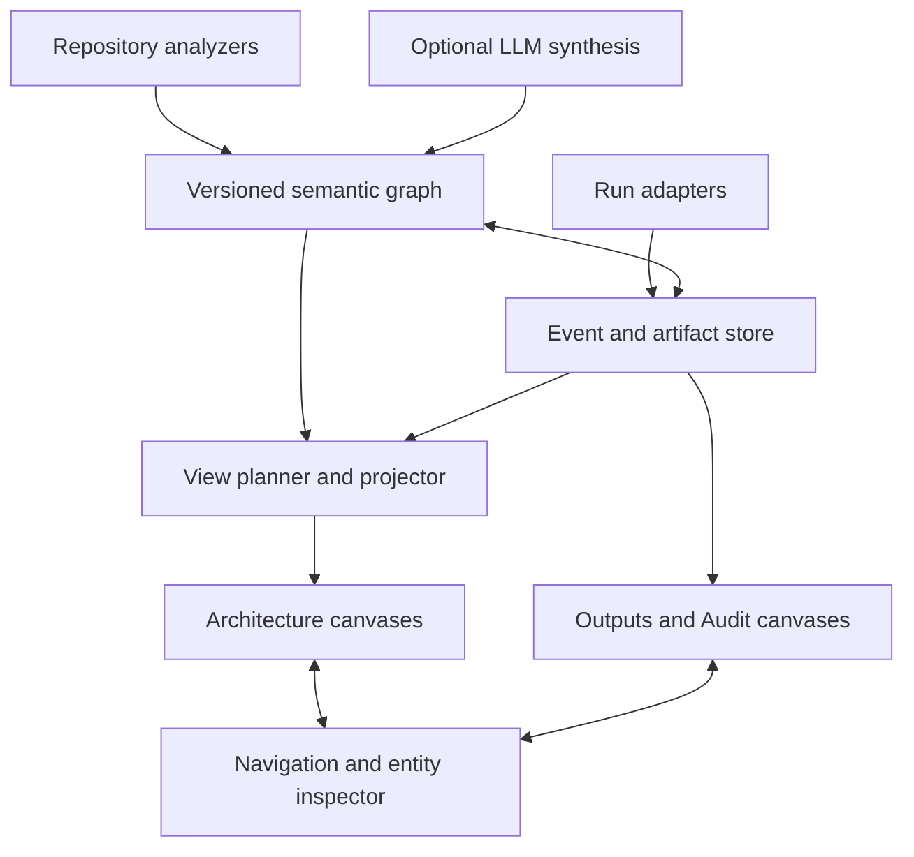

# System Atlas — implementation plan and Claude Code handoff

Prepared for Michael May · 26 October 2026

## 1. Product decision

Build a local, project-aware architecture and execution-evidence workspace. Opening a repository discovers its software boundaries, constructs a persistent semantic graph, and generates the relevant nested and sibling canvases. Changes to code incrementally update that graph and affected views. A separate Outputs & Audit workspace shows actual runs, browser-agent screenshots, command results, generated files, rendered artifacts, and failures, linked back to architecture components and exact source revisions.

Working name: **System Atlas**. The name is provisional.

Recommended starting point: **a small TypeScript monorepo using React Flow, ELK.js, SQLite, a local Node service, and Playwright integration.** Use existing libraries rather than implementing a canvas engine. Treat Skena as an optional rendering/editor adapter, and Subcanvas as a design reference for recursive navigation. Do not begin with a wholesale Skena or Subcanvas fork.

Why: the difficult new capabilities live below the canvas: reliable repository analysis, semantic identity, evidence provenance, incremental reconciliation, runtime ingestion, and source-to-output correlation. A separate core keeps these useful in a browser, VS Code, Skena, CI, and headless Claude Code. Skena could be a faster route to a narrow VS Code-only prototype; this recommendation optimizes the complete requested system and a reusable engine. It is a design judgment, not a measured benchmark of the alternatives.

Do not publish or deploy anything as part of this handoff. The requested deliverable is a runnable local project.

## 2. Requirements and honest boundaries

### Required experience

1. Run `atlas open /path/to/repository`, or select **Open in Atlas** in VS Code.
2. See a useful initial project map from deterministic inspection before any model call finishes.
3. Allow optional model-assisted synthesis to propose meaningful subsystems, explain relationships, and fill missing perspectives with evidence-linked hypotheses.
4. Open components into child canvases; move between siblings without losing position; inspect crosscutting views such as data, deployment, security boundaries, and request flows.
5. Inspect any entity or relationship to see its source locations, extraction method, confidence category, source revision, freshness, and conflicting evidence.
6. Edit code and see only affected views update, preserving manual organization and annotations.
7. Open a distinct **Outputs & Audit** root to inspect actual execution evidence, then jump from an output or failing step to the responsible architecture component and code.
8. Operate offline for local analysis, browsing, and imported evidence; optional model-backed enrichment requires whichever provider the user configures.

### What “any software system” means

Universal input contract and extensible analyzers; progressively deeper support by ecosystem. Every repository gets a generic inventory and capability report. Supported stacks get framework-aware analysis. Unsupported languages, remote services, dynamic dispatch, generated code, and unavailable infrastructure remain visible as coverage gaps. Never silently equate file coverage with semantic understanding.

The product supports web applications, services, libraries, command-line tools, data pipelines, agent systems, native/mobile applications, infrastructure repositories, and monorepos. Initial implementation validates TypeScript/JavaScript and Python first, then Go and Java/JVM, then other analyzers through the same contract. Existing supported telemetry can describe any language's runtime independently of static analyzer depth.

“Every relevant canvas” means every view meeting explicit relevance and evidence rules for the current snapshot. It does not mean a canvas for every folder, every symbol, or every hypothetical behavior. Catalog every eligible view automatically; materialize its heavy layout and content when opened. No fixed global recursion depth; enforce cycle prevention and per-view complexity limits.

### Not a promise

No complete call graph for arbitrary programs, automatic access to all deployed environments, historical screenshots that were never captured, or observability of agents without integration. A screenshot proves a captured visual state, not that an entire workflow succeeded. Process success requires an exit result; task success requires an assertion or human judgment. These are separate fields.

## 3. Starting-point assessment

| Candidate | Reuse | Decision |
|---|---|---|
| React Flow / xyflow | Typed custom nodes, handles, interactions, parent/child grouping | Primary renderer; build explicit canvas navigation separately |
| ELK.js | Hierarchical/compound layout and edge routing | Layout worker behind an interface; deterministic input order and pinned layout version |
| SQLite | Entity/relationship indexes, view specs, event queries, migrations | Local canonical materialized state; FTS search; no graph database initially |
| Skena | JSON Canvas, VS Code context, canvas-aware agents, rich content | Optional adapter after the core vertical slice; inspect current license/API before reuse |
| Subcanvas | Recursive canvases, code links, agent-editable boards | Strong UX reference; avoid importing hosted account/billing/collaboration dependencies |
| Playwright | Browser instrumentation, screenshots, traces, browser tests | Primary first-party browser evidence adapter |
| OpenTelemetry | Trace/span identity and causal relationships | Accept a documented subset first; do not promise a complete collector |
| Tree-sitter and language tooling | Syntax extraction plus ecosystem-specific semantic resolution | Incremental extraction; parsers alone do not resolve program semantics |
| JSON Canvas / Mermaid | Portable diagrams and compatibility | Export/import projections; neither owns runtime or architecture truth |

Check actual dependency versions, licenses, native packaging behavior, upstream commit IDs, and API compatibility during bootstrap. Preserve notices when copying upstream code. React Flow grouping does not itself provide recursive file navigation or an architecture engine. Do not assume public source means permissive licensing.

## 4. System architecture



Separate four models:

1. **Semantic model:** what exists, relationships, observations, evidence, and uncertainty.
2. **View model:** which subset is shown, why that view exists, parent and sibling navigation, filters, and layout intent.
3. **Presentation overlay:** positions, pinned nodes, annotations, collapsed regions, selected layout, viewport, and user labels.
4. **Execution model:** actual runs, steps, events, spans, artifacts, result assertions, and correlation claims.

The same semantic entity can appear in several views with one stable identity and different view-local positions. The entity graph may be cyclic; the primary ownership hierarchy and canvas navigation tree must be acyclic. A crosscutting canvas can have multiple incoming navigation links but one canonical owner or explicit workspace-root ownership. Do not duplicate entities to imitate hierarchy.

## 5. Local layout and repository structure

Use a pnpm workspace and TypeScript strict mode. Suggested structure:

```text
apps/web/                 React + Vite + React Flow
apps/daemon/              local HTTP API, filesystem watcher, job scheduler
apps/cli/                 atlas commands
packages/schema/          Zod schemas, migrations, public contracts
packages/graph/           snapshots, semantic identity, reconciliation
packages/analyzers/       generic, TS/JS, Python and future adapters
packages/planner/         canvas eligibility, hierarchy, projections
packages/layout/          ELK worker, incremental placement
packages/evidence/        event ingestion, artifacts, redaction
packages/adapters/        Playwright, process, OTLP subset, agent imports
packages/agent-api/       MCP server and provider adapter contracts
packages/export/          JSON Canvas, Mermaid, static bundle
extensions/vscode/        workspace launch, source navigation, status
extensions/skena/         optional compatibility bridge
fixtures/                 small, deterministic representative systems
docs/                     architecture, contracts, capability matrix
```

Project config lives in `.atlas/config.yaml`; optional human-authored overrides in `.atlas/overrides.yaml`; optional shareable view specifications in `.atlas/views/`. Exclude local secrets and volatile evidence from git.

Store databases, caches, screenshots and run artifacts in the platform's user-data directory, namespaced by project ID and worktree ID. Never store credentials, captured user data, huge traces, or mutable SQLite files in a target repository by default. An explicit portable export produces sanitized, selected data. Adding ignore/config files to a target repository is an explicit CLI initialization action, not a side effect of merely opening it.

Canonical project identity is a generated UUID associated with a root registration. Worktrees and checkouts are separate analysis contexts. Record remote URLs only when available, and normalize/redact embedded credentials.

## 6. Canonical data contracts

All persistent contracts have `schemaVersion`. Use opaque IDs and validated discriminated unions. The examples below specify required semantics; refine field names once and document the exact schemas.

### Analysis snapshot

`Snapshot { id, projectId, worktreeId, headCommit?, dirtyTreeDigest, createdAt, analyzerVersions, configDigest, state, coverageReportId }`.

Never label uncommitted source as identical to HEAD. Use a manifest of included file content hashes to identify the analyzed tree. A snapshot progresses through building, partial, ready, failed, superseded; the UI keeps the previous valid snapshot visible until publication. Coverage is scoped to the exact input manifest.

### Entity and relation

`Entity { id, projectId, kind, canonicalName, displayName, ownerEntityId?, lifecycle, attributes, firstSeenSnapshot, lastSeenSnapshot }`.

Kinds include system, external-system, deployable, package, module, symbol, entrypoint, endpoint, database, table, queue, topic, job, workflow, agent, tool, configuration, infrastructure-resource, UI-surface and artifact-type. Not every analyzer supplies every kind.

`Relation { id, fromId, toId, kind, evidenceIds, status, confidenceCategory, snapshotId }`.

Kinds include contains, imports, calls, exposes, reads, writes, publishes, subscribes, invokes-tool, deploys-to, configures, produces and depends-on. A relation's identity includes endpoints, kind, and relevant qualifiers such as route or channel. Preserve multiple independent supporting observations. Distinguish an unresolved reference from a verified external service.

### Evidence and claims

`Evidence { id, sourceKind, repoRelativePath?, contentHash?, startLine?, endLine?, snapshotId?, runId?, eventId?, extractorId, extractorVersion, capturedAt, excerpt?, redactionState }`.

`Claim { id, subjectId, predicate, value, origin, evidenceIds, status, modelMetadata?, inputDigest? }`.

Origins: parser, manifest, framework-analyzer, runtime, human, model. Status: supported, inferred, unresolved, conflicted, stale, rejected. Confidence categories are interpretable labels, not fake calibrated probabilities. Runtime evidence is authoritative for what that captured run observed; it is not proof of every possible execution or source truth.

Model metadata records provider/model identifier, prompt-template version and input hashes where available. Record requests, tool activity and concise explanations needed for reproducibility; do not request or store hidden chain-of-thought.

### View specification and overlay

`CanvasSpec { id, rootEntityId?, ownerCanvasId?, lens, title, query, relevanceReason, snapshotId, generationVersion, state, coverageSummary }`.

`CanvasLink { fromCanvasId, toCanvasId, relation: child|sibling|related|evidence, viaEntityId? }`.

`ViewOverlay { viewId, userIdOrLocalProfile, entityPositions, pinnedIds, annotations, displayOverrides, viewport, revision }`.

Use AST/structured view queries with limits; do not accept arbitrary SQL from model tools. Preserve semantic source labels separately from user display labels. A user annotation never becomes an extracted fact without an explicit human assertion action.

### Runs, events and artifacts

`Run { id, projectId, worktreeId?, snapshotId?, sourceManifestDigest?, adapter, commandSummary?, startAt, endAt?, status, exitCode?, environmentSummary, instrumentationCapabilities, captureGaps }`.

`Event { id, producerId, producerEventId, schemaVersion, runId, sequence?, occurredAt, receivedAt, type, traceId?, spanId?, parentSpanId?, causalEventIds, entityRefs, payload, artifactIds }`.

`Artifact { id, sha256, mediaType, byteLength, localObjectKey, runId, eventId?, logicalName, role, capturedAt, sourceRevision?, redactionState, previewState, retentionClass }`.

`Correlation { id, eventOrArtifactId, entityId, method, evidenceIds, status }`.

`Assertion { id, runId, eventId?, subjectArtifactId?, source: test|human|adapter, outcome: pass|fail|unknown, description, evidenceIds }`.

Event types cover run started/completed/failed/cancelled; step started/completed/failed; tool call requested/completed; command stdout/stderr chunks and exit; screenshot captured; network summary; file produced; render produced; assertion result; human override; graph update and model enrichment. Keep lifecycle failure separate from ingestion failure.

## 7. Automatic architecture discovery

### Pipeline

1. **Inventory:** obey `.gitignore` and `.atlasignore`; enumerate tracked and eligible untracked files; skip vendor/build caches, binaries and secrets; detect workspace boundaries, manifests, languages, deployment files, schemas, documentation and entrypoints. Do not follow symlinks outside registered roots by default.
2. **Deterministic extraction:** parse manifests, imports, symbols, explicit exports, schemas, routes, job registrations, queue bindings, agent/tool registries and infrastructure references as supported by an analyzer. Record exact evidence locations/content hashes.
3. **Resolution:** resolve package/module names using ecosystem configuration. TS/JS should use compiler/module resolution where practical; Python should report ambiguous imports and environment-dependent resolution. Tree-sitter supplies syntax, not universal semantic resolution.
4. **Boundary synthesis:** detect deployables/packages/services from actual entrypoints and configuration. Folder structure is a useful clue, not the architecture. Preserve alternate boundary hypotheses when evidence conflicts.
5. **Optional model synthesis:** supply bounded evidence slices plus existing facts; request schema-validated claims and view proposals. Models can group, explain and propose; their output cannot overwrite observed facts or insert uncited dependencies as supported relations.
6. **Validate and reconcile:** enforce valid endpoints, acyclic ownership, unique IDs and evidence integrity; publish a new snapshot atomically; generate an explicit change summary.
7. **Plan views:** evaluate relevant lenses and build the catalog; layout visible views lazily.

### Analyzer interface

Each analyzer exports `detect(context)`, `capabilities()`, `extract(files, snapshotContext)`, `affectedBy(changeSet)`, and optional `resolve(observations, context)`. Outputs are normalized observations and diagnostics. Run expensive parsers in workers. Cancellation, timeouts, per-file failures and memory limits are required. A failing analyzer cannot erase previously known facts as though it successfully analyzed an empty project.

### Initial deep adapters

TS/JS: package/workspace boundaries, imports/exports, functions/classes, common server routes, UI route/surface declarations where explicit, build/config entrypoints. Python: module imports, functions/classes, explicit FastAPI routes, CLI entrypoints, selected task/job patterns. Generic: Docker Compose, Dockerfiles, OpenAPI, SQL migrations, package metadata, common CI configuration. Add each framework detector with a small documented capability boundary and fixture.

Later Go/Java/Rust/native/mobile support uses dedicated tooling and adapters. Do not add dozens of regex detectors and call the result comprehensive. For any unsupported file, offer source browsing and mark semantic analysis unavailable.

## 8. Canvas generation policy

Create two permanent workspace roots: **Architecture** and **Outputs & Audit**. Architecture begins with system context, project structure/boundaries, and coverage. Generate other lenses conditionally:

| Canvas/lens | Creation rule | Content |
|---|---|---|
| System context | Always | System, actors if evidenced, external dependencies, unknown boundaries |
| Deployables | Deployment or process boundaries detected | Services, executables, workers, deployment links |
| Subsystem/component | Meaningful owned entities or high coupling | Component responsibilities and dependencies |
| Package/module detail | Supported symbols and relations warrant drilldown | Internal public interfaces and dependencies |
| API/interface | Explicit interfaces, routes or schemas exist | Endpoints, contracts, consumers where supported |
| Data | Stores, models, migrations or data jobs detected | Storage, schema relationships and read/write flows |
| Workflow/request | Explicit handlers, job chains or observed traces exist | Static possible flow or observed run, clearly labeled |
| Agent/tool | Agent registries, tool calls or agent traces exist | Agents, tools, handoffs, outputs |
| UI/navigation | Routes/screens/components are detected | Screen hierarchy and actual captured screenshots when available |
| Deployment | Infrastructure/config evidence exists | Runtime placement, resources, configuration references |
| Trust boundaries | Auth/permission/network evidence exists | Evidenced boundaries; no implied security certification |
| Changes/impact | Snapshot comparison exists | Changed entities, potential dependents, evidence invalidation |
| Coverage/unknowns | Always | Unsupported files, unresolved references, stale claims, missing telemetry |

Each eligible owner/lens pair gets a stable view ID. Parent-child views follow semantic ownership. Sibling lenses share an owner; related links represent dependencies across ownership boundaries. One component may expose API, data and deployment sibling views.

Default detail target: 10–30 meaningful nodes. Above 40, cluster or introduce child views; users can override. Avoid one-child chains that add no information. Show aggregation explicitly and retain a searchable full graph. Relations exiting a child view become labeled boundary ports with navigation to their actual destination. Condense strongly connected components for flow layout without deleting cyclic relationships.

Relevance uses a deterministic base score from evidence availability, entrypoints, interface count, meaningful boundary, coupling and runtime significance. Version the scoring policy. Models may propose names or additional lenses, but relevance and evidence checks gate automatic inclusion. Users can pin a view, suppress a proposed view, or promote an inferred boundary. Those overrides survive regeneration.

Generating a catalog entry is cheap; projecting and rendering it is lazy. Unopened views still show scope, freshness and relevance. A large monorepo must not produce thousands of loaded React components at startup.

## 9. Continuous maintenance and edit reconciliation

Watcher debounce starts around 750 ms, configurable. Coalesce rapid changes, hash content, skip no-ops, parse the changed dependency closure, and cancel obsolete jobs. File churn must not trigger repeated model calls.

Identity precedence: explicit recorded identity where available; language-qualified symbol/package identity; stable source anchors; rename detection and structural similarity as a candidate only. If rename matching is ambiguous, create a reconciliation issue instead of silently merging unrelated nodes. Line numbers are evidence locators, not entity IDs.

Three-way merge: previous generated state + new generated state + human overlay. Preserve pinned positions, notes and accepted display overrides. New nodes go into open space or a bounded changed region; do not rearrange the entire map. Deleted entities become tombstones for historical snapshots; current views can show a removed state during change review. An extraction failure marks old content stale and retains it.

Invalidate claims when their evidence file hashes or relevant dependency signatures change. Recompute affected views and higher-level summaries; limit reverse-dependency traversal using actual relation types and configured bounds. Cache enrichment by input digest, schema and prompt/model versions. On branch switches or worktree changes, select the correct analysis context and never attach a run to a different dirty tree.

Use a single writer queue and SQLite transactions for snapshot publication. Handle filesystem races by validating the manifest before commit, retrying only changed slices, and labeling a continuously changing tree as partial. Snapshot restore changes Atlas state only; it never rewrites target code.

## 10. Outputs & Audit workspace

This is a separate navigation root with its own layouts, filters and retention. It shares entity identity with Architecture and supports side-by-side navigation.

### Required canvases

1. **Outputs overview:** recent runs, current run, final outputs, failures, capture coverage and links to relevant components.
2. **Run detail:** hierarchical step graph with source revision, status, timing, tools and produced outputs.
3. **Browser journey:** chronological screenshot filmstrip plus causal action links, page URL, tab identity, action status and selected network/console summaries.
4. **Code execution:** command step, working directory alias, stdout/stderr, exit code, test assertions and produced files.
5. **Artifact gallery:** actual image, HTML, PDF, chart, video, JSON/CSV/text and build-output previews with source/run links.
6. **Audit trail:** append-only event timeline, graph changes, model proposals, human overrides, ingestion gaps and provenance.
7. **Run comparison:** compare selected outputs and assertions across compatible runs; label environment/viewport/revision differences.

For every output, answer: what produced this, when, from which source snapshot, under what observed environment, with what evidence of success, and which component is linked? If correlation is unknown, show unknown rather than fabricating responsibility.

### Browser-agent screenshots

Build a first-party Playwright capture helper that wraps an explicitly instrumented browser context/page. Capture initial state, configured action milestones, navigation completion, failures, final state and manual bookmarks. Default screenshot frequency should be bounded; optionally capture before/after each meaningful action. Screenshots are real captured bytes, not generated illustrations.

Attach page/tab ID, URL with sensitive query fields redacted, viewport, action/event ID, run ID, trace/span identity if available, timestamp and image hash. Use an adapter-level sequence or causal links to establish ordering, not cross-machine timestamps alone. Label captures as pre-action, post-action, failure-state or sampled-state. A post-action image is not a guarantee that asynchronous application work finished; record the capture wait policy.

Enable Playwright traces for configured sessions and link to a local Trace Viewer. Do not reimplement its internal replay engine or depend on undocumented trace ZIP internals for the core event contract. Separate screenshots and step events generated by our wrapper provide the stable integration.

Third-party browser agents must send events/artifacts through SDK, MCP recording calls, hooks, or an importer. File-watching an approved screenshot directory is a degraded adapter: it cannot reliably reconstruct missing actions. Show its reduced capabilities. Never claim to observe every browser agent automatically.

### Command and code outputs

`atlas run -- <executable> <args...>` runs a configured local command, streams bounded logs, records exit/signal/cancellation, and stores declared output paths. Pass argument arrays without shell interpolation by default. Provide SDK `recordArtifact` for programs that know their outputs. Filesystem observation may flag candidates but does not prove a particular process produced them without correlation.

Render text/code with size caps, JSON as expandable data, CSV as paginated tables, images as thumbnails/full view, PDFs through an isolated viewer, and videos with native controls. Do not execute notebook cells merely to display imported outputs. Notebook outputs can be imported as existing evidence; execution requires a configured runner.

For HTML and application previews: distinguish an existing captured artifact from opening a live service. Serve untrusted generated HTML from an isolated preview origin or sandboxed opaque-origin iframe with network denied by default. Strip/reject active SVG and risky content unless isolated. Never render arbitrary artifact HTML inside the privileged app origin. Record preview creation as a derived artifact with its renderer version and original hash. Provide Playwright screenshot rendering for approved local application URLs.

### Correlating evidence to architecture

Prefer explicit entity IDs in SDK events, then entrypoint/command mapping, stack/source map locations and framework route signatures. Trace context and span links connect asynchronous work where present. Filename/time proximity is a heuristic, visibly labeled. Support manual relinking with a recorded override. Runs reference the architecture snapshot that existed when they ran, not whichever snapshot is current when viewed.

## 11. Audit integrity, ingestion and retention

Ingest immutable normalized events into an append-only database table with producer deduplication on `(producerId, producerEventId)`. Store source records when allowed, normalized payloads and adapter versions. Rebuild query projections from retained events. Out-of-order ingestion, duplicated deliveries and late artifacts are normal conditions. Missing parents create placeholders resolved when evidence arrives. Unfinished runs become interrupted/unknown after recovery rather than falsely successful.

Use content-addressed artifact storage with SHA-256, MIME sniffing, atomic writes, size limits and verified manifests. One object may be referenced by multiple runs. Upload protocol should reserve artifact metadata, stream bounded bytes, verify hash/size and finalize the reference; events can reference pending artifacts. Garbage collection respects every retained snapshot/run reference and pinned evidence.

Optional per-stream hash chaining improves local corruption/tamper detection. State clearly that a hash chain on a user-controlled computer is not independently authenticated audit proof. External signing or anchored checkpoints would require a separate design. Exported audit data must disclose capture gaps, redaction and deletion; never silently rewrite history.

Default proposed limits, all configurable: 30 days of unpinned run data, 5 GiB total project artifacts, 100 MiB per ordinary artifact, 10 MiB inline log preview per run, thumbnail cache separately reclaimable. Traces/videos can use explicit larger limits. Before quota cleanup, retain metadata and mark deleted bytes as unavailable; pinned evidence is not evicted. Redaction/deletion events document removals without retaining the removed secret in the event itself.

## 12. Agent integration and model budget

Expose an MCP server with structured semantic operations:

- `atlas_project_status`, `atlas_list_views`, `atlas_get_view`, `atlas_get_entity`, `atlas_get_evidence`, `atlas_search`.
- `atlas_refresh` with scope and dry-run option; refresh uses the core engine.
- `atlas_propose_claims`, `atlas_propose_view`, `atlas_annotate`; proposals carry evidence and snapshot preconditions.
- `atlas_start_run`, `atlas_record_event`, `atlas_record_artifact`, `atlas_finish_run` for instrumented agents.
- `atlas_get_run`, `atlas_list_artifacts`, `atlas_get_artifact_metadata`.

Do not expose arbitrary filesystem access, SQL execution or command execution through default canvas tools. Graph mutations must go through schema validation and snapshot preconditions. Read tools paginate and apply context budgets. Return relevant evidence and selected neighborhoods rather than dumping an entire repository into the model.

Optional model provider interface: `enrich(evidenceBundle, existingClaims, outputSchema, budget, abortSignal)`. Support an externally connected coding agent through MCP as the first practical enrichment path; add direct API providers separately. Do not depend on undocumented Claude Code local session formats, authentication internals, or an assumed subscription API. Claude Code implements the project; Atlas must still function without a running Claude session.

Suggested default budget: deterministic analysis always; model enrichment on initial user-enabled scan, meaningful semantic changes, or explicit request. Track estimated and reported usage separately; stop at configured spending/token limits, cancel superseded requests, reuse cached results and expose pending/stale summaries. A test/mock provider is mandatory for deterministic CI.

Prompt injection: repository text, READMEs, traces, screenshots and tool results are untrusted data. They cannot change system instructions, authorize commands, enable network capture or exfiltrate secrets. Restrict provider inputs to allowlisted, redacted evidence and validate all output. Do not autonomously run a repository's installation/build scripts just to analyze its architecture.

## 13. UX specification

Left navigation: project/worktree selector; Architecture and Outputs & Audit roots; searchable canvas catalog; recently visited and pinned views. Center: one active canvas, optional split view. Right inspector: summary, source references, evidence, relevant runs, freshness, coverage and unresolved issues. Bottom strip: analysis progress or live run timeline.

Double-click a component to open its best child view. A lens menu switches API/Data/Implementation/Deployment siblings. Breadcrumbs and back/forward preserve viewport. Selecting an output highlights correlated components; selecting a component offers **Show outputs**. A run has a persistent revision badge. Historical views carry a visible snapshot indicator.

Distinguish supported facts, inferred relationships, stale data and human annotations by label/icon as well as color. Provide **Why this canvas?**, **Why this edge?**, **What is missing?**, and **Last changed**. Collapse busy regions, use search and keyboard navigation, and lazy-load images. For dense canvases render summaries at low zoom and detail at high zoom. Accessibility includes keyboard traversal, readable list/table alternatives and reduced motion.

Provide separate exports for an architecture snapshot, selected run evidence and a combined sanitized bundle. JSON Canvas export includes portable nodes, edges and relative artifact links; richer metadata lives in a versioned sidecar. No guarantee another renderer preserves Atlas's complete semantics. Mermaid export is a selected simplified view.

## 14. Local API and operational controls

CLI target interface:

```bash
atlas open /path/to/project
atlas scan /path/to/project --no-model
atlas watch /path/to/project
atlas status --json
atlas views list --json
atlas run -- npm test
atlas import /path/to/approved-run-bundle
atlas export --snapshot <id> --output /path/to/bundle
atlas doctor
```

`atlas run` assumes a project context resolved from cwd or explicit config; command execution is user-initiated. Command profiles can be registered once to support later automatic runs within their exact scope. Opening/scanning never executes target application code.

API capabilities include project registration, scan jobs, snapshot/entity queries, view queries/overlays, run/event/artifact ingestion, artifact byte serving and SSE updates. Define actual route shapes in an OpenAPI or equivalent typed contract. Use stdio MCP for local agents and an authenticated loopback HTTP server for UI/SDK. Bind loopback by default, validate Origin/Host, use scoped ingestion credentials and avoid logging tokens. Select an available port and communicate it through a local discovery record protected by OS file permissions. Do not expose the service on a LAN by default.

User-approved capture scope includes project paths, commands, local URLs, allowed output directories and redaction rules. Reject traversal and symlink escapes on ingestion. Never access browser profile cookies or unrelated browser sessions. Redact credentials from environment/arguments, selected URL parameters, logs and payload fields; screenshot masking must happen before persistence when configured. Flag that visual redaction and pattern filters are best effort and minimize capture of sensitive environments.

Crash recovery: write-ahead logging, migration backups, resumable scans, idempotent ingestion and orphan cleanup. A daemon failure must not corrupt target code or prevent opening the previous snapshot. Expose failures in `atlas doctor` and UI. Avoid storing full environment dumps.

## 15. Phased delivery and acceptance criteria

### Phase 0 — verify assumptions and scaffold

Inspect upstream source/licenses and pin dependencies; create ADRs for renderer, core/view separation, local persistence and event contract. Build the monorepo, schema package, migrations, daemon, CLI, UI shell and fixture harness. Document capability boundaries. Do not spend this phase on collaboration, authentication providers, billing or desktop packaging.

Acceptance: clean checkout installs, typechecks and starts via documented commands; a fixture can be registered without modifying it; all persistence paths and contracts are explicit.

### Phase 1 — useful architecture vertical slice

Implement generic inventory, TS/JS extraction, Python extraction, graph snapshots, evidence inspector, initial view planner, stable IDs, nested/sibling navigation, deterministic layout and manual position overlays. Support context, deployables/components where detected, interfaces, dependencies and coverage. A model is optional.

Acceptance: TS web/service fixture and Python CLI/API fixture generate different relevant views; every supported edge opens evidence; unsupported features appear as gaps; a second identical scan causes no semantic/view churn; a single-file change updates affected state; a manual pin survives refresh; branch/worktree contexts stay separate.

### Phase 2 — real outputs vertical slice

Implement run/event/artifact schemas, process wrapper, Playwright capture helper, ingestion deduplication, Outputs overview, run graph, screenshot filmstrip, command logs and artifact gallery. Add source-to-run correlation and sandboxed previews. Complete this before broad model sophistication.

Acceptance: a real fixture browser journey captures screenshots of three steps and a failure; a real CLI run records stdout/stderr and produces a JSON file and an image; both appear in Outputs & Audit and link to the correct snapshot; a failed assertion remains failed despite exit code 0; a missing screenshot appears as missing; malicious HTML cannot read app storage or execute with app privileges.

### Phase 3 — continuous reconciliation and richer view planning

Implement watcher, dirty digests, rename handling, cancellation, atomic publish, boundary-port navigation, semantic diffs, coverage summaries, deterministic relevance scoring, model proposals/cache/budgets and context-scoped MCP reads. Add API/Data/Workflow/Agent/Deployment lenses as supported by fixtures.

Acceptance: rapid edits coalesce; stale inference is invalidated; failed extraction does not erase good state; overlays survive renames where identity is supported; ambiguous renames surface as issues; model output with invented evidence is rejected; cross-view selection uses a single entity identity.

### Phase 4 — integrations and wider language support

Add VS Code launcher/source navigation, documented OpenTelemetry trace subset ingestion, generic agent event SDK, imported run bundles and optional Skena bridge/JSON Canvas export. Add Go and Java/JVM analyzer coverage with explicit capability reports. Inspect Skena's current API before deciding whether a separate extension or small upstream contribution is best; the core remains independent.

Acceptance: an external instrumented agent records a run through public tools; late/duplicate events reconcile; a VS Code workspace opens the correct worktree; supported JSON Canvas exports open in the selected renderer with relative asset links; unsupported export features are disclosed. OTLP incompatibilities produce diagnostics, not silent dropped evidence.

### Phase 5 — scale, portability and daily-use hardening

Add run comparisons, retention, migration/backup/restore tests, sanitized exports, large-repository performance checks, offline packaging verification, user documentation and self-analysis. Atlas should map its own architecture and show evidence from its own test runs.

Acceptance: a reproducible self-demo explains which views are inferred versus observed; all phase checks pass; a clean machine can follow the README; no hosted service is mandatory for local analysis or evidence viewing.

Do not assign calendar estimates until Phase 0 confirms source/dependency constraints. Deliver each phase as a runnable increment and record remaining scope; never represent a scaffold as the complete product.

## 16. Verification strategy and evaluation fixtures

Use meaningful tests at the contracts and failure boundaries. Fixtures: TS UI + API + worker + queue + SQL store; Python API + batch/CLI; agent with two tools and browser evidence; mixed-language monorepo with shared schema; library-only repository; unsupported-language repository; runtime-only external service reference. Expected graph assertions are hand-authored and independent of extractor output.

Required checks:

- Static extraction precision/recall for explicitly labeled fixture relations; report per-analyzer/per-relation results, not one inflated overall score.
- Navigation ownership is acyclic; dependencies may cycle; cross-boundary edges remain navigable.
- All generated supported claims reference valid snapshot evidence; rejected/stale/conflicting evidence stays inspectable.
- Stable rescans, rename ambiguity, branch switches, deleted files, dirty changes and user-overlay preservation.
- Duplicate/out-of-order events, interrupted runs, missing parent spans, missing bytes and artifact hash mismatch.
- Command failure, cancellation and failed assertions; accurate browser screenshot provenance and tab ordering.
- XSS, malicious SVG, path traversal, escaping symlinks, untrusted repo instructions and credential redaction.
- Migration restore, retention reference safety and offline operation without a model.
- UI end-to-end test: open project → nested component → evidence → associated run → screenshot → source.

Performance targets are provisional acceptance budgets, measured on a declared machine and fixture: visible canvas at most 200 detailed nodes; cached snapshot open within 2 seconds; single ordinary source-file deterministic update within 3 seconds; first useful summary for a 10k-file fixture within 15 seconds excluding models; complete deep analysis allowed to continue in background. Report p50/p95, file counts, artifact sizes and hardware. If unmet, implement bounded degradation and document results instead of inventing successful metrics. Large screenshots/traces never enter graph-query JSON payloads.

## 17. Prioritized implementation tickets

| ID | Ticket | Depends on | Done when |
|---|---|---|---|
| A01 | Bootstrap workspace, contracts and ADRs | — | Local apps start and schemas validate |
| A02 | Project/worktree identity and SQLite migrations | A01 | Independent dirty/branch contexts persist |
| A03 | Inventory and coverage report | A02 | Safe generic map works on unknown repo |
| A04 | TS/JS and Python analyzers | A03 | Evidence-backed fixture assertions pass |
| A05 | Semantic identity and snapshot reconciler | A04 | No-op rescan stable; failures retain valid state |
| A06 | View planner and canvas navigation | A05 | Automatic nested/sibling views and gap view |
| A07 | React Flow, layout worker, overlays and inspector | A06 | Usable interactive architecture vertical slice |
| E01 | Run/event/artifact store and ingestion | A02 | Idempotent validated persistence |
| E02 | Process wrapper and output registration | E01 | Real logs, exits and produced files recorded |
| E03 | Playwright capture helper | E01 | Real screenshots, action events and trace links |
| E04 | Output canvases and isolated preview renderer | E02,E03,A07 | Real output-to-source walkthrough works |
| M01 | Watcher and incremental invalidation | A05,A07 | Bounded changes with overlay preservation |
| M02 | Model proposal validation, cache and budget | M01 | Optional enrichment cannot invent supported facts |
| I01 | MCP and generic event SDK | E01,A06 | External agent reads map and records evidence |
| I02 | VS Code integration | I01 | Current workspace/worktree opens and source jumps |
| I03 | OTLP subset and bundle importer | E04 | Defined compatibility and gap diagnostics |
| I04 | Skena/JSON Canvas bridge | I01,A07 | Portable projections without core dependency |
| H01 | Retention, recovery, export and performance | E04,M01 | Documented failure and scale checks pass |

Keep one runnable vertical slice as the priority. Dependencies describe implementation ordering, not a requirement to launch parallel agents.

## 18. Concrete demonstration scenario

Use a fixture application that accepts a research topic, queues a worker, invokes a browser agent, extracts data and writes a report. Opening it generates context, deployables, API, data, worker/agent and deployment views when supported. Expanding the worker reveals its modules and tool bindings. A sibling data canvas shows report storage and provenance.

Run its test journey through the capture helper: the browser opens a local page, searches, captures a results screenshot, and the worker writes JSON plus a rendered report. Outputs & Audit shows that run, screenshot sequence, command/test outcomes and report preview. Clicking the report opens its producing step and correlated worker. Change the report schema; Atlas invalidates affected data/interface views and marks the old output as produced by the earlier snapshot. A later run is compared without rewriting the earlier audit trail.

Use entirely local fixture pages and fake data so the demo is reproducible without external accounts, internet services or real user information.

## 19. Paste-ready Claude Code implementation prompt

Copy this section into Claude Code and attach this entire plan file. The plan is the specification; the prompt is the execution instruction.

> Build **System Atlas** according to the attached plan. It is a local architecture and execution-evidence workspace for arbitrary software repositories, with deeper analysis through explicit language/framework adapters. It automatically maintains relevant nested and sibling architecture canvases and a separate Outputs & Audit workspace containing real run events, browser screenshots, code outputs and rendered artifacts linked to source snapshots.
>
> Start by inspecting the current directory, repository instructions, and installed toolchain. If this is an existing unrelated repository, create the Atlas implementation in a clearly separate sibling directory or worktree and preserve the existing project. Do not overwrite unrelated work. Verify the current source, license, versions and APIs of dependencies before adopting or copying them. Record exact dependency versions and inspected upstream commits. Follow the plan's default: React Flow + ELK.js + SQLite + TypeScript local daemon/CLI, with optional VS Code and Skena adapters. If inspection exposes a material incompatibility, write a short ADR and choose the nearest compatible local implementation that preserves the public contracts; do not stall on routine choices.
>
> Create `IMPLEMENTATION_STATUS.md` and a concise `CLAUDE.md` containing the architecture invariants, phase checklist, setup commands, capability boundaries and validation commands. Implement Phase 0, then a complete Phase 1 architecture vertical slice and Phase 2 real-output vertical slice before broadening language support or adding elaborate AI behavior. Continue into subsequent phases as practical; maintain an accurate completed/remaining checklist so work can resume across context windows. Do not stop at a plan, mock UI, or generated screenshots.
>
> Canonical semantic entities, view specifications, presentation overlays and runtime evidence are separate. All supported claims have traceable evidence. Inferred claims are labeled and validated. Stable IDs, worktree/dirty-tree isolation, incremental updates, atomic snapshots and preservation of user overlays are required. Unsupported code and missing instrumentation must appear as visible coverage gaps. Runtime evidence links to the source snapshot of the run, and audit history remains inspectable. No model is required for deterministic analysis or evidence viewing.
>
> Implement a representative TS and Python fixture and a real local Playwright journey that captures screenshots, plus a command producing inspectable files. Show actual artifacts in Outputs & Audit with logs, assertions and source links. Keep application previews isolated from the privileged UI. Use documented public integrations, not private Claude session/auth formats. Do not execute arbitrary target-repository scripts during analysis; execution and capture use explicit user-initiated commands or configured profiles.
>
> Run the tests appropriate to each completed increment, including the provenance, reconciliation, ingestion, preview-isolation and UI walkthrough checks in this plan. Inspect the rendered local UI with available browser tooling. Record actual commands and results, unresolved failures, unsupported capabilities and measured performance. Never claim a phase passed if its acceptance criteria have not been exercised. Produce a clean-machine README and one reproducible local end-to-end demo. Do not deploy or publish. Finish with what works, how to start it, what was verified, and the next unfinished ticket.

## 20. Research references and verification notes

These sources ground library capabilities and integration patterns. The proposed architecture, prioritization and thresholds above are design recommendations. They do not assert that any existing project already implements the complete specification. Research was documentation-level; no upstream project was installed or benchmarked for this plan.

- Skena: https://github.com/dmarienko/skena — VS Code JSON Canvas environment, canvas-aware agent interactions, rich content and MCP integration. Recheck current source and license before extending.
- Subcanvas: https://github.com/subcanvas/subcanvas — nested boards/pages, source links, MCP, repository import; initial import is documented as a one-time copy. AGPL-3.0 at inspection.
- React Flow: https://github.com/xyflow/xyflow and https://reactflow.dev/learn/layouting/sub-flows — rendering foundation and parent/child node grouping. Atlas supplies semantic recursion and navigation.
- ELK.js: https://github.com/kieler/elkjs — verify the current maintained package, layout options and license during Phase 0; confirm native/worker packaging constraints.
- Tree-sitter: https://tree-sitter.github.io/tree-sitter/ — incremental parsing; semantic resolution requires additional language-specific work.
- Playwright Trace Viewer: https://playwright.dev/docs/trace-viewer — real recorded browser-trace inspection; Atlas supplies its own stable event and artifact contracts.
- Playwright screenshots: https://playwright.dev/docs/screenshots — inspect current screenshot and masking APIs when implementing the capture helper.
- OpenTelemetry tracing API: https://opentelemetry.io/docs/specs/otel/trace/api/ — spans, contexts and causal links; specify Atlas's supported ingestion subset explicitly.
- JSON Canvas: https://jsoncanvas.org/ — check current schema before implementing portable export.

## 21. Recommended first release boundary

The first useful release includes automatic TS/Python architecture maps, nested/sibling navigation, evidence and coverage inspection, stable updates, real command outputs, real Playwright screenshot journeys, artifact previews, and source/run cross-navigation. It operates locally without models and supports optional enrichment through documented agent tools. Rich deployment analysis, broad language coverage, run comparison, collaboration and desktop packaging follow only after this loop works reliably.

The durable design principle: **one evidence-backed semantic graph, many generated views, and a separate execution record connecting what the system is believed to be with what it actually did.**
